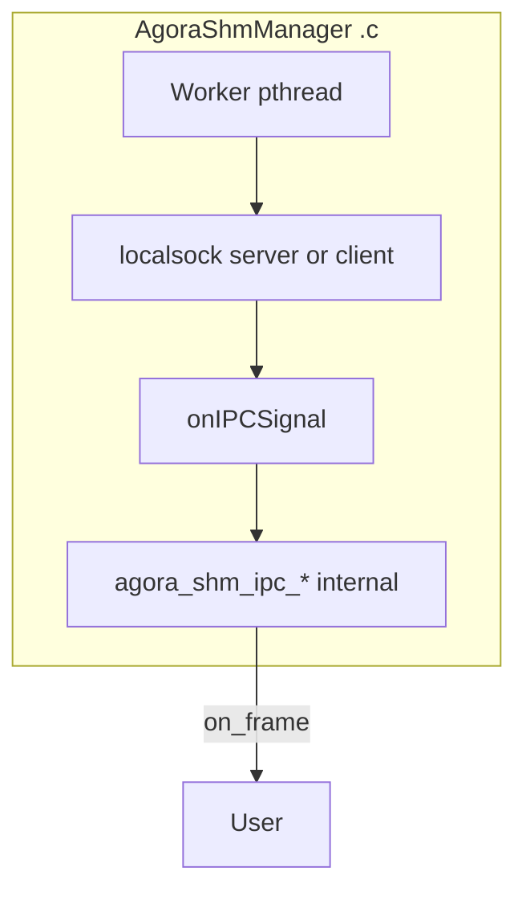

# agora_shm_manager 规划（组合层：SHM IPC + localsocket）

本文档为 **重设计** 版本，取代原先「Unix notify + manager 表」为主线的描述。实现语言：**纯 C**（C11）。**与旧版实现不并存**：落地时以本 PLAN 为准 **替换** [`agora_shm_manager.h`](src/agora_shm_manager.h) / [`agora_shm_manager.c`](src/agora_shm_manager.c) 与 **`agora_manager_demo`** 等依赖路径，不再保留「Unix notify + 三参数 demo」并存形态。

## 一、总体规范

1. **组合层**：`agora_shm_manager` 是对 **[`agora_shm_ipc`](src/agora_shm_ipc.h)**（POSIX SHM + seqlock）与 **[`agora_localsock`](src/agora_localsock.h)**（127.0.0.1 UDP）的 **组合编排层**，对外暴露 **`AgoraShmManager`** 与 `agora_shm_manager_*` API。
2. **信令与唤醒**：manager 仅通过 **localsocket**（见 [`PLAN_localsocket.md`](PLAN_localsocket.md)）；仓库已移除 **`agora_shm_ipc_notify`** 模块。
3. **类型隐藏（定稿修订）**：公开头文件中 **不出现** `AgoraShmIpc`、`AgoraShmIpcNotify` 指针及 **`agora_localsock_*` 符号**。**`on_frame` 使用 [`AgoraShmIpcHeader`](src/agora_shm_ipc.h)** 快照（与 `agora_shm_ipc_read` 的 `out_hdr` 一致；manager.h **`#include "agora_shm_ipc.h"`** 用于 `AgoraShmIpcHeader`、`AgoraShmIpcFrameMeta` 及必要常量；**不得**在公开 API 中暴露 `AgoraShmIpc *` 等句柄）。`AgoraShmIpc` / `agora_localsock_*` **仅**出现在 **manager.c** 内部。
4. **纯 C**：`pthread`；**`bool`** 使用 `<stdbool.h>`。

## 二、对外 API（目标签名）

```c
#include <stdbool.h>
#include <stddef.h>
#include <stdint.h>

#include "agora_shm_ipc.h"   /* AgoraShmIpcHeader in on_frame; FrameMeta for add/write */

typedef struct AgoraShmManager AgoraShmManager;

typedef void (*agora_shm_manager_on_frame_fn)(
    const char *shm_name,
    const void *payload,
    size_t len,
    const AgoraShmIpcHeader *hdr,
    void *user);

/**
 * port: UDP 端口（127.0.0.1），必须 > 0；port==0 非法，返回 -EINVAL 且 errno=EINVAL。
 * server_mode: true=localsocket server bind port；false=client connect 127.0.0.1:port。
 * localsock_max_clients: 仅 server 模式传入 `agora_localsock_server_create` 的 max_clients；client 模式可忽略（实现传占位或忽略）。
 * localsock_keepalive_ms: 传入 server 的 keepalive_interval_ms（5× 超时）；与 client 侧线程内 500ms keepalive **独立**（见 3.2）。
 * max_read_cap: 工作线程读 SHM scratch 上限（0=实现内默认）。
 */
int agora_shm_manager_start(agora_shm_manager_on_frame_fn on_frame,
                            uint16_t port,
                            bool server_mode,
                            size_t localsock_max_clients,
                            uint32_t localsock_keepalive_ms,
                            void *user,
                            size_t max_read_cap,
                            AgoraShmManager **out);

void agora_shm_manager_close(AgoraShmManager *m);

/** 写表登记：`agora_shm_ipc_open(..., is_creator=1)` + `writer_session_begin`。
 *  max_payload_size 即 IPC payload_size，须非零（EINVAL）。写表/读表各最多 256 条；
 *  若 shm_name 已在写表或读（自动附着）表：EEXIST。表满：ENOMEM。 */
int agora_shm_manager_add(AgoraShmManager *m, const char *shm_name,
                          size_t max_payload_size);

/** 先写表按名发送 REMOVECMD、close、unlink 并删除清单记录；否则只移除
 *  本地读表项；皆无则 ENOENT。 */
int agora_shm_manager_remove(AgoraShmManager *m, const char *shm_name);

/** 音频拷贝入 pre-buffer，由 worker 定时合并写入；视频立即写 SHM 并发送 WRITECMD。 */
int agora_shm_manager_write(AgoraShmManager *m, const char *shm_name,
                            const void *data, size_t len,
                            const AgoraShmIpcFrameMeta *meta);
```

### 回调与 `hdr` 生命周期（定稿）

- **`hdr` 指针**指向与当前帧一致的 **`AgoraShmIpcHeader`** 快照（栈上或实现内缓冲）；**仅在 `on_frame` 回调返回前有效**，返回后不得再使用，**业务不得持有裸指针跨异步**。

## 三、实现逻辑

### 3.1 `port` 与校验

- **`port == 0` 或 `port` 表示非法 UDP 端口**：**`agora_shm_manager_start` 失败**，`errno = EINVAL`。
- **`server_mode == true`**：`agora_localsock_server_create(port, localsock_keepalive_ms, localsock_max_clients, ...)`。
- **`server_mode == false`**：`agora_localsock_client_create(port, ...)`（connect 到 `port`）。

### 3.2 工作线程与 client keep-alive（定稿）

- **一条** worker `pthread`。
- **Server 模式**：在 transport 锁内非阻塞调用 **`agora_localsock_server_poll`**，收到数据后释锁进入 **`onIPCSignal`** 链路（见 3.4）。无数据时在锁外等待 10ms；client 采用相同的非阻塞收包与空闲等待方式。
- **Client 模式**：循环 **`agora_localsock_client_poll`**（见 [`PLAN_localsocket.md`](PLAN_localsocket.md) 新增 API）+ 定时逻辑：除 poll 外，**每 500ms** 调用一次 **`agora_localsock_client_send_keepalive`**（由 manager 线程承担，**不**要求业务再驱动；与「独立使用 localsock 客户端时由业务发 keepalive」可并存——见 localsock PLAN 备注）。
- **音频发送**：同一 worker 在 transport 恢复前检查各写槽的 **10ms 单调时间截止时间**；每次最多合并 4 个 metadata 一致且总长度能放入 SHM 的输入帧，写入一次并通知一次。延迟后只发一批，下一截止时间从当前时刻计算。
- **`localsock_keepalive_ms`**：仅用于 **server** 侧 peer 超时（`5×`）；**不**作为上述 500ms 的来源。

### 3.2.1 通道自动恢复

- worker 启动成功后，仅主动 `close()` 才退出。接收缓冲在启动线程前分配。
- 实际收包错误后在锁外等待 20ms；`EBADF/ENOTSOCK`（含 `POLLNVAL`）
  触发重建，其他 socket 错误连续 3 次后重建。正常轮询后清零，正常超时、
  `EINTR`、暂时无数据不计数。keepalive 失败同样等待、重试并在必要时重建。
- 只替换 localsock，保留端口、server 配置、SHM 映射、读写表、缓存和持久化
  所有权。失败重建每隔 20ms 重试，客户端重建后立即发送 keepalive。
- `poll()` 在恢复期间先消费缓存，没有可读数据则返回 `-EAGAIN`；正常情况下
  未挂接仍为 `-ENOENT`，缓存为空仍为 `0`。音频 `write()` 拷贝入队，后续发送
  错误异步记录；视频先写 SHM，恢复期间通知返回 `-EAGAIN`，不回滚。
  所有 manager 同步失败返回 `-errno` 并设置 `errno`。
- 日志输出到 stderr，不限流，不持业务锁或 transport 锁输出。
- 上层先停止并等待业务 API 调用结束再 `close()`；close 唤醒等待、join worker
  后再释放资源。不得从帧回调中 close。等待使用单调时间。
- 不增加公开恢复/状态 API，不补发通知、不做登记同步、不补历史帧。

### 3.3 `onIPCSignal`（实现内 static，不进头文件）

- 收到一帧 **localsocket UDP 负载** 后调用 `onIPCSignal(recv_buffer, recv_len)`。
- **首版**：可仍为 **空实现**；后续解析 **`agora_localsock_header` + `msg_type==APP` 的 payload**（见 3.5），再驱动内部 SHM 与 `on_frame`。

### 3.4 与 SHM IPC（规划）

- 实现文件内 `#include` `agora_shm_ipc.h` / `agora_localsock.h`；**`on_frame` 在成功 `agora_shm_ipc_read` 后、释锁后调用**。

### 3.5 APP 报文 payload 格式（定稿）

- **`msg_type == AGORA_LOCALSOCK_MSG_APP`（2）** 时，**payload 主体**为 **`AgoraShmIpcHeader` 的整头裸字节**，长度为 **`sizeof(AgoraShmIpcHeader)`**，便于从中读取 `shm_name`、`payload_size`、`magic`/`version` 等并 **`agora_shm_ipc_open` / `agora_shm_ipc_read`**。
- UDP 报文布局：**12 字节 `agora_localsock_header`** + **`payload_len` 字节**，其中上述情况 **`payload_len == sizeof(AgoraShmIpcHeader)`** 且内容为一帧头镜像。

### 3.6 `agora_shm_manager_add` / `agora_shm_manager_remove`

- **读表 / 写表**：内部 **`read_entries`**（UDP 自动附着读，最多 256）与 **`write_entries`**（`add` 登记的写端创建，最多 256）分离；**`close`** 时两套表项均 **`agora_shm_ipc_close`**。
- **`add`**：`agora_shm_ipc_open(shm_name, max_payload_size, is_creator=1)` + **`agora_shm_ipc_writer_session_begin`**，并尽力把名称写入 `/var/lib/agora/shm-manager` 下本 manager 的清单；状态登记失败仅记录日志，保留 SHM 并完成内存写表登记，不回滚、不使媒体创建失败。`max_payload_size == 0` → `EINVAL`；写表或读表已存在同名 → **`EEXIST`**；写表满 → **`ENOMEM`**；实际 SHM 失败透传 **`errno`**。
- **`remove`**：先查写表；命中后发送 REMOVECMD、close、unlink 并删除清单记录。否则只从读表移除，不发送信令且不 unlink；两处都无 → **`ENOENT`**。
- **UDP 派发**：若 `shm_name` 已在写表登记，**不再**为该名自动打开读附着（避免同 manager 内读写双持同一名的歧义）。

### 3.7 WRITECMD 与 `agora_shm_manager_write`

- **`msg_type == AGORA_LOCALSOCK_MSG_WRITECMD`（3）**：UDP 负载为 **`sizeof(AgoraShmIpcFrameMeta)`** 的裸 meta；接收侧若读表尚无该 `shm_name`，则 **`shm_open` + `mmap` 头** 探测 **`payload_size`** 后再 **`agora_shm_ipc_open` 附着读** 并 **`agora_shm_ipc_read` / `on_frame`**（与 APP 头镜像路径等价信息）。
- **`agora_shm_manager_write`**：仅在**写表**命中 `shm_name` 时接受数据；**`meta/data` 不可为 NULL**，单次长度不能超过 SHM payload。视频立即调用 `agora_shm_ipc_write` 并发送通知。
- **音频 pre-buffer**：每个写槽持有独立 FIFO，拷贝 payload 和 metadata；返回 0 表示已入队。有效 PCM 输入必须非空且采样点对齐。每 10ms 最多合并 4 帧，合并长度不超过已登记 SHM 容量；要合并完整 4 帧需在 add 时预留容量。
- **实时性**：发送端最多保留 200ms PCM 和 64 个输入帧，超限丢最旧完整帧；一个超过 200ms 但能放入 SHM 的输入可单独保留。格式变化清除旧队列，remove/close 释放未发送数据。接收端 poll 缓存保留最新 200ms，格式变化时清空并重新分配。
- **通知**：写后 server 向已登记 peer 广播 WRITECMD，client 向 server 发送。server 无 peer 仍返回 0。音频异步发送失败记录日志，不重放已提交批次；单槽 SHM 仍无可靠交付确认。

### 3.8 REMOVECMD 与异常退出恢复

- **`msg_type == AGORA_LOCALSOCK_MSG_REMOVECMD`（4）**：UDP 负载为固定 64 字节 SHM 名称。接收侧严格校验长度和 NUL 结尾，只 close 并清空同名 `read_entry`；没有读槽时幂等忽略，绝不清理写槽或调用 `shm_unlink`。
- **所有权**：谁调用 `agora_shm_manager_add` 创建写 SHM，谁负责在 remove/close 时发送 REMOVECMD 并 unlink。读侧只释放自己的映射。
- **磁盘清单**：尽力在 `/var/lib/agora/shm-manager` 下创建独立状态目录和 `flock` 锁。start 逐级创建缺失的父目录和根目录，新建目录权限为 `0700`，保留已有目录权限；跳过仍锁定的活跃实例，对失锁清单逐项执行 `shm_unlink`。状态初始化/回收失败仅记录日志，继续启动并跳过后续状态更新。remove 清单更新失败仅记录日志；close 仍清理所有内存写表中的 SHM，清单更新失败时尽力保留已有恢复记录。缺少有效清单的对象在异常退出后可能残留，且同名创建可能返回 `EEXIST`。
- **多进程 / Pod**：同端口多个 client manager 通过独立目录隔离。宿主机进程与 Pod 协作时，通过 `hostPath` 共享同一节点的 `/var/lib/agora/shm-manager`，并配置匹配的有效 UID 和写权限；仅同一 Pod 内多容器可使用共享 `emptyDir`。无创建权限时由部署预先创建并授权。旧 `/tmp/agora_shm_manager` 清单不自动迁移。

## 四、与旧版差异（摘要）

| 项目 | 旧版 | 新版 |
|------|------|------|
| 信令 | （已移除独立 notify 模块） | localsocket UDP |
| demo | 三参数 Unix 路径 | **仅** port + server_mode + localsock 参数（不并存） |
| `add`/`remove` | 有逻辑 | **读写分表** + `add(max_payload_size)` / `remove` 按名 |

## 五、并发与生命周期

- **`agora_shm_manager_close`**：stop → **join** → 对写槽发送 best-effort REMOVECMD → 关闭全部槽位并 unlink 创建方写 SHM → 销毁 localsock → 删除本 manager 状态目录 → `free`。
- **禁止持锁**调用 `on_frame`。

## 六、依赖与构建

- 链接：**`agora_shm_ipc.o`** + **`agora_localsock.o`** + **`agora_shm_manager_state.o`** + **`pthread`**。

## 七、图示



## 八、实施顺序

1. 在 **`agora_localsock`** 实现 **`agora_localsock_client_poll`**（见 PLAN_localsocket）。
2. 重写 **`agora_shm_manager.h` / `.c`** 与 **`agora_manager_demo`**，删除旧 notify 启动路径，**不并存**。
3. 实现 `start` / `close` / 线程 / 500ms client keepalive / `onIPCSignal` 占位或解析。
4. 后续：`onIPCSignal` 全逻辑、`add`/`remove`、表驱动 `on_frame`。

---

**文档版本**：2026-04-15；合并定稿：**`AgoraShmIpcFrameMeta` 回调**、**`localsock_max_clients` + `localsock_keepalive_ms`**、**`agora_localsock_client_poll`**、**client 线程 500ms keepalive**、**port 非法规则**、**add/remove ENOSYS**、**不并存**、**APP payload = 整头 `AgoraShmIpcHeader`**。
